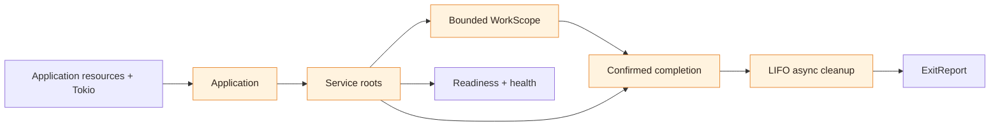

<p align="center">
  
</p>

<h1 align="center">miju-services</h1>

<p align="center"><strong>Service lifecycles. Owned background work. Explicit cleanup.</strong></p>

<p align="center">
  
  
  <a href="LICENSE"></a>
</p>

<p align="center">English · <a href="README.zh-CN.md">简体中文</a></p>

<p align="center">
  <a href="#installation">Installation</a> ·
  <a href="#usage">Usage</a> ·
  <a href="#examples">Examples</a> ·
  <a href="#how-miju-services-works">Lifecycle</a> ·
  <a href="#cargo-features">Features</a>
</p>

A Rust service foundation built on [miju](https://github.com/nanfeng-labs/miju).
Assemble application services, observe their readiness and health, and stop them
with an explicit account of background work and resource cleanup. Your application
owns the Tokio runtime, business configuration, resources, and logging destinations.

## Features

- **Service assembly** — validate a static dependency graph and stop dependents before providers.
- **Readiness and health** — distinguish completed initialization from changing operational health.
- **Owned work** — bound and track asynchronous, blocking, and externally aggregated responsibilities.
- **Explicit shutdown** — distinguish a stop request, a budget result, and actual completion.
- **Asynchronous cleanup** — retain cleanup ownership and report failures in reverse registration order.
- **miju integration** — attach existing Workers and Monitors; keep execution and retries in miju.
- **Direct periodic work** — run one async operation on a fixed delay or a grid that skips busy ticks.

## Installation

Requires **Rust 1.89+** and a caller-owned Tokio runtime with time enabled.
For a local checkout:

```toml
[dependencies]
miju-services = { path = "../miju-services", default-features = false }
tokio = { version = "1.53.3", features = ["rt", "time", "sync", "macros"] }
```

Omit `default-features = false` to enable the `miju` and `periodic` integrations.
See [Cargo features](#cargo-features) for the complete list.

## Usage

Provide a service closure, mark it ready after initialization, and keep the host
alive until the final report. This example also registers an asynchronous cleanup:

```rust
use miju_services::{Application, BoxError, Health, ServiceSpec, service_fn};
use std::{sync::Arc, time::Duration};
use tokio::sync::Mutex;

#[tokio::main(flavor = "current_thread")]
async fn main() -> Result<(), BoxError> {
    let saved = Arc::new(Mutex::new(false));
    let cleanup_saved = saved.clone();
    let app = Application::builder()
        .service(
            ServiceSpec::new("collector"),
            service_fn(move |context| async move {
                let cleanup = move || async move {
                    *cleanup_saved.lock().await = true;
                    Ok::<(), BoxError>(())
                };
                if let Err(rejected) = context.defer_cleanup("save", cleanup) {
                    // Registration did not transfer ownership; finish it here.
                    rejected.into_cleanup()().await?;
                    return Err(std::io::Error::other("cleanup registration closed").into());
                }
                match context.set_health(Health::Healthy).and_then(|()| context.ready()) {
                    Ok(()) => {}
                    Err(_) if context.is_stopping() => {}
                    Err(error) => return Err(error.into()),
                }
                context.stopping().await;
                Ok::<(), BoxError>(())
            }),
        )
        .build()?;

    // This host already owns a runtime and chooses not to retry startup.
    let control = app
        .start()
        .map_err(|error| std::io::Error::other(error.to_string()))?;
    let observer = control.observer();
    let ready = observer.ready(Duration::from_secs(5)).await;
    // A real host waits for its own exit signal after successful readiness.
    let budget = control.shutdown().await;
    let exit = observer.wait().await;
    println!("shutdown: {budget:?}; final: {exit:?}");
    // Do not leave the runtime on a readiness error before cleanup finishes.
    ready?;
    budget?;
    let report = exit?;
    assert!(*saved.lock().await);
    if !report.is_success() {
        return Err(std::io::Error::other("application failed; inspect report").into());
    }
    Ok(())
}
```

`start` requires an active Tokio runtime with time enabled. Without a runtime,
`StartError::into_application()` recovers the unstarted application for a later
attempt. `StartError` owns that application and is not a `Send + Sync` boxed error;
the example deliberately converts its diagnostic because this host does not retry.
The library does not install an OS signal handler or a logging subscriber.

Report health and readiness after actual initialization. `ready()` latches
initialization, while health may change later. If shutdown wins the race, a
`ContextClosed` notification error with `is_stopping() == true` proceeds to normal
cleanup. This does not justify ignoring unrelated business or I/O errors, or
abandoning execution already owned by the service.

## Examples

Run any example from the checkout with `cargo run --locked --example NAME`.
Core examples also support `--no-default-features`.

| Example | Demonstrates | Required feature |
| --- | --- | --- |
| [basic](examples/basic.rs) | Dependencies, managed work, flush/close cleanup | None |
| [startup_failure](examples/startup_failure.rs) | Initialization failure and cleanup | None |
| [miju_worker](examples/miju_worker.rs) | A Worker owned by a service | `miju` |
| [miju_monitor](examples/miju_monitor.rs) | A Monitor with its existing restart policy | `miju` |
| [periodic](examples/periodic.rs) | Serial asynchronous rounds | `periodic` |
| [cron_worker](examples/cron_worker.rs) | miju-cron directly feeding a Worker | `miju` |
| [bounded_queue_rounds](examples/bounded_queue_rounds.rs) | Admission bounds and final receipts across retries | `miju` |
| [embedded_runtime](examples/embedded_runtime.rs) | Independent applications sharing a host runtime | None |

## How miju-services works



The application supplies resources through explicit closure captures. The lifecycle
driver owns service execution, tracks admitted work, and retains cleanup actions
until they finish. Snapshots and reports expose progress to the host.

### Core concepts

- `Application` validates a static dependency graph and starts an independent lifecycle driver.
- `Service` is a once-owned root, adapted from a closure with `service_fn`. Dependencies are captured explicitly.
- `ServiceContext` reports initialization and current health, accepts cleanup during initialization, and exposes the root's `WorkScope`.
- `WorkScope` bounds and owns asynchronous, blocking, or externally aggregated work. A result handle observes work without owning its only execution responsibility.
- `AppHandle` requests shutdown. `AppObserver` reads snapshots, the shutdown budget result, and actual final completion.

Services default to required residents. A finite service completes its operation and
children; a resident remains alive until stopped. Dependencies must be required
services. Shutdown waits for a dependent root and its work before stopping its
provider. The graph orders lifetimes; it does not construct or inject resources.

### Stop, completion, and cleanup

`stop()` requests shutdown and returns immediately. `shutdown().await` also waits
for the shared budget result: `Completed` contains an exit report; `Incomplete`
contains the responsibilities still pending. Defaults are a 30-second cooperation
budget plus one shared second for abort confirmation. Later completion does not
rewrite an earlier `Incomplete` result.

`observer.wait().await` waits without a time limit for actual completion.
`observer.drain(duration).await` limits observation and can return `Pending` or
`DriverLost`; it does not request shutdown. Canceling an observer does not cancel
the driver. Dropping the last control handle only requests stop. Keep the runtime
running until actual completion, or explicitly transfer runtime and observation
responsibility to a continuing host.

Each root has a bounded work scope, defaulting to 1024 outstanding responsibilities.
`close()` rejects new work; `wait()` waits for the closed scope to finish and does
not include the root itself. Ordinary work errors are recorded; `fail_service()`
opts into service failure propagation. The `WorkReport` returned by a work handle's `wait().await` must have
`completion() == WorkCompletion::Confirmed` before its result can establish that
its responsibility is released.

Already-started blocking work cannot be forcibly stopped. An aggregate work item
requires its caller to provide a trustworthy completion barrier for all external
execution; an error leaves `Unconfirmed` responsibility. Such work can prevent
provider shutdown and final cleanup indefinitely. A timeout or a dropped handle
is not proof of resource release.

Register asynchronous cleanup during initialization, immediately after acquiring
its resource. Successful registration transfers ownership; rejection returns the
closure through `into_cleanup()`. Cleanup runs in reverse registration order after
all roots and work have actually finished. Errors are retained while later cleanup
continues; a pending cleanup is not dropped because an observer times out.
`is_drained()` and `is_success()` answer different questions. External resource
references, detached application tasks, and remote device effects are outside the
library's automatic completion proof.

## Integrations

### Existing miju execution

Use `miju::worker(context, worker.stream())` with the exact context supplied to
`WorkerBuilder`. The bridge consumes Start before requesting stop, then keeps
polling the same stream to EOF. A finite source should use `Lifetime::Finite`.
Start declares the driver established; initialize remote dependencies before that
point when business readiness requires it. Execution errors are retained in
`ServiceSnapshot::execution_errors` and its bounded recent errors. A backend driver
error or forced cancellation leaves backend cleanup unconfirmed.

`miju::monitor(monitor)` attaches one whole Monitor and preserves its restart
policy. Internal worker errors may be delayed until resident siblings stop; attach
workers separately when application-level failure must propagate immediately.
Any restart history retains unconfirmed backend cleanup even if the replacement
finishes successfully: Monitor success cannot certify an earlier failed backend.
The `miju_worker` and `miju_monitor` examples exercise both entry points.

### Direct periodic work

Provide a rule and one asynchronous round to `periodic::periodic(rule, operation)`.
It becomes an ordinary service without a target registry or queue. `FixedDelay`
waits after actual business completion; `FixedRateSkip` keeps the origin grid and
skips busy opportunities. With a five-second period and a first round lasting eight
seconds, the next round starts at second 13 or second 10 respectively. A late wake
runs once at the latest due grid point and does not replay all missed ticks.

The first round defaults to immediate execution. Returned business errors default
to `Continue` and remain observable; `StopService` escalates them. Panics, arithmetic
faults, and execution failures stop the periodic root. An active round receives a
read-only stop context and may finish asynchronous cleanup before returning. See
`examples/periodic.rs`; `ServiceSnapshot::periodic` retains counters and last-round
timing, while the scope retains bounded work errors.

### Calendar and queued rounds

Run `cargo run --locked --example cron_worker` for a calendar source directly
feeding a miju Worker. This uses miju-cron with a UTC cron schedule. Source
prefetch and downstream backpressure can deliver an already-due tick later;
this is not `FixedRateSkip` and does not promise completion-relative timing.
The example and tests do not certify local-time DST transitions.

Run `cargo run --locked --example bounded_queue_rounds` for two rounds with
five seconds between a final receipt and the next submission. The private
example adapter bounds queued plus executing/retrying jobs with one permit,
skips an already-owned target, and holds its permit until the job is released.
The producer depends on the worker and waits for the accepted round's receipt
before allowing worker shutdown. A dropped receipt observer does not cancel the job.

`ReceiptLayer` wraps the complete user retry chain: success/failure is final
for that chain, while dropping an unfinished job reports cancellation. This
example uses MemoryStorage's Identity acknowledgement; its receipt is not a
promise of durable acknowledgement for other backends. Jobs still queued when
the owning backend is dropped are cancelled, not persisted or replayed.

## Cargo features

| Feature | Capability |
| --- | --- |
| `--no-default-features` | Ordinary service, work, observation, and cleanup modules |
| `periodic` (default) | Serial fixed-delay or fixed-grid work, without business retries |
| `miju` (default) | Worker and Monitor lifecycle bridges using miju-core without its default features |
| `docsrs` | Feature documentation generation |
| `tracing` | Structured snapshot and lifecycle failure events; no subscriber is installed |


## Development

```sh
cargo test --locked --all-features --all-targets
cargo test --locked --all-features --doc
cargo test --locked --no-default-features
cargo fmt --all -- --check
cargo clippy --locked --all-features --all-targets -- -D warnings
cargo doc --locked --all-features --no-deps
```

Use these commands to validate the capabilities currently included in this batch.
[CI](.github/workflows/ci.yaml) defines the checks; configuration is not evidence of
hosted execution. See the [GitHub tooling guide](.github/README.md) for repository
configuration and release requirements.

## Brand assets

The [header logo](assets/miju-services-header.svg) extends the miju citrus identity
with a service lifecycle symbol. The [social preview PNG](assets/miju-services-social-preview.png)
is ready for a repository social preview upload; its
[SVG source](assets/miju-services-social-preview.svg) remains editable.

## License

[MIT](./LICENSE) — copyright 2026 RivTian.
