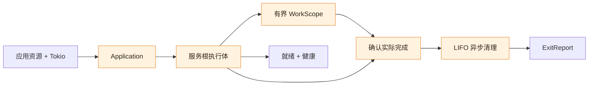

<p align="center">
  
</p>

<h1 align="center">miju-services</h1>

<p align="center"><strong>服务生命周期、受管后台工作与明确的资源清理。</strong></p>

<p align="center">
  
  
  <a href="LICENSE"></a>
</p>

<p align="center"><a href="README.md">English</a> · 简体中文</p>

<p align="center">
  <a href="#安装">安装</a> ·
  <a href="#用法">用法</a> ·
  <a href="#示例">示例</a> ·
  <a href="#工作原理">生命周期</a> ·
  <a href="#cargo-features">功能开关</a>
</p>

建立在 [miju](https://github.com/nanfeng-labs/miju) 之上的 Rust 服务基座。
装配应用服务，观察就绪与健康状态，并在停止时明确报告后台工作和资源清理的完成情况。
应用负责 Tokio 运行时、业务配置、资源以及日志输出位置。

## 功能

- **服务装配**：校验静态依赖图，停止时先等待使用方，再停止其依赖的提供方。
- **就绪与健康**：区分初始化完成和运行期间可变化的健康状态。
- **受管工作**：限制并跟踪异步、阻塞及外部聚合工作的责任数量。
- **明确停止语义**：区分停止请求、停止预算结果与实际完成。
- **异步清理**：持续持有清理责任，按注册的逆序执行并报告失败。
- **miju 接入**：接入现有 Worker 和 Monitor，执行与重试仍交给 miju。
- **直接周期工作**：运行一轮异步操作，支持完成后延时或按固定时间网格触发、忙则跳过。

## 安装

需要 **Rust 1.89+**，以及由调用方持有、启用了时间功能的 Tokio 运行时。
使用本地仓库时：

```toml
[dependencies]
miju-services = { path = "../miju-services", default-features = false }
tokio = { version = "1.53.3", features = ["rt", "time", "sync", "macros"] }
```

去掉 `default-features = false` 即可启用默认的 `miju` 和 `periodic` 接入能力。
完整列表见 [Cargo features](#cargo-features)。

## 用法

提供服务闭包，在初始化完成后报告就绪，并让宿主保持运行，直到收到最终报告。
下面的示例还注册了一项异步清理：

```rust
use miju_services::{Application, BoxError, Health, ServiceSpec, service_fn};
use std::{sync::Arc, time::Duration};
use tokio::sync::Mutex;

#[tokio::main(flavor = "current_thread")]
async fn main() -> Result<(), BoxError> {
    let saved = Arc::new(Mutex::new(false));
    let cleanup_saved = saved.clone();
    let app = Application::builder()
        .service(
            ServiceSpec::new("collector"),
            service_fn(move |context| async move {
                let cleanup = move || async move {
                    *cleanup_saved.lock().await = true;
                    Ok::<(), BoxError>(())
                };
                if let Err(rejected) = context.defer_cleanup("save", cleanup) {
                    // 注册未转移归属，在此完成清理。
                    rejected.into_cleanup()().await?;
                    return Err(std::io::Error::other("cleanup registration closed").into());
                }
                match context.set_health(Health::Healthy).and_then(|()| context.ready()) {
                    Ok(()) => {}
                    Err(_) if context.is_stopping() => {}
                    Err(error) => return Err(error.into()),
                }
                context.stopping().await;
                Ok::<(), BoxError>(())
            }),
        )
        .build()?;

    // 宿主已持有运行时，此处选择不重试启动。
    let control = app
        .start()
        .map_err(|error| std::io::Error::other(error.to_string()))?;
    let observer = control.observer();
    let ready = observer.ready(Duration::from_secs(5)).await;
    // 真实宿主在成功就绪后等待自己的退出信号。
    let budget = control.shutdown().await;
    let exit = observer.wait().await;
    println!("shutdown: {budget:?}; final: {exit:?}");
    // 即使就绪失败，也须等清理结束后再退出运行时。
    ready?;
    budget?;
    let report = exit?;
    assert!(*saved.lock().await);
    if !report.is_success() {
        return Err(std::io::Error::other("application failed; inspect report").into());
    }
    Ok(())
}
```

`start` 要求当前存在启用了时间功能的 Tokio 运行时。没有运行时时，可以通过
`StartError::into_application()` 取回尚未启动的应用，稍后重试。
`StartError` 持有该应用，不能直接转换为要求 `Send + Sync` 的装箱错误；
示例中的宿主不重试启动，因此只转换其诊断信息。本库不安装操作系统信号处理器或日志 subscriber。

应在实际初始化完成后报告健康和就绪。`ready()` 锁存初始化完成状态，健康状态则可以继续变化。
如果停止请求先发生，通知操作返回 `ContextClosed` 且 `is_stopping() == true` 时，应进入正常清理。
这不意味着可以忽略无关的业务或 I/O 错误，也不意味着可以放弃服务已接管的执行责任。

## 示例

在仓库中使用 `cargo run --locked --example NAME` 运行示例。
核心示例也支持 `--no-default-features`。

| 示例 | 展示内容 | 所需 feature |
| --- | --- | --- |
| [basic](examples/basic.rs) | 依赖、受管工作、flush/close 清理 | 无 |
| [startup_failure](examples/startup_failure.rs) | 初始化失败与清理 | 无 |
| [miju_worker](examples/miju_worker.rs) | 由服务持有的 Worker | `miju` |
| [miju_monitor](examples/miju_monitor.rs) | 保留现有重启策略的 Monitor | `miju` |
| [periodic](examples/periodic.rs) | 串行异步周期工作 | `periodic` |
| [embedded_runtime](examples/embedded_runtime.rs) | 多个独立应用共享宿主运行时 | 无 |

## 工作原理



应用通过闭包显式捕获资源。生命周期驱动负责服务执行，跟踪已接纳的工作，
并持有清理动作直到其完成。宿主通过快照与报告观察进度。

### 核心概念

- `Application`：校验静态依赖图，启动独立的生命周期驱动。
- `Service`：只消费一次的服务根执行体，通过 `service_fn` 从闭包适配，显式捕获依赖。
- `ServiceContext`：报告初始化与当前健康状态，在初始化期间接收清理动作，并提供该根的 `WorkScope`。
- `WorkScope`：限制并持有异步、阻塞或外部聚合工作。结果句柄负责观察，不独占执行责任。
- `AppHandle`：请求停止。`AppObserver`：读取快照、停止预算结果及实际最终完成情况。

服务默认为必需的常驻服务（Required、Resident）。有限服务（Finite）完成自身操作和子工作后结束；
常驻服务则持续运行直到停止。被依赖的服务必须是必需服务。
停止时，先等待使用方的根执行体和工作结束，再停止提供方。依赖图规定生命周期顺序，不构造或注入资源。

### 停止、完成与清理

`stop()` 请求停止并立即返回。`shutdown().await` 还会等待共享的预算结果：
`Completed` 包含退出报告；`Incomplete` 包含仍未完成的责任。
默认给予 30 秒协作停止时间，再给予共享的 1 秒等待中止确认。
稍后的实际完成不会改写先前的 `Incomplete` 结果。

`observer.wait().await` 不设时限地等待实际完成。
`observer.drain(duration).await` 限制观察时长，可能返回 `Pending` 或 `DriverLost`，但不会请求停止。
取消观察不会取消驱动；丢弃最后一个控制句柄只会请求停止。
应让运行时保持运行直到实际完成，或将运行时和观察责任明确移交给持续运行的宿主。

每个根都有有界工作域，默认最多持有 1024 项未完成责任。
`close()` 拒绝新工作；`wait()` 等待已关闭的工作域完成，不包括根执行体本身。
普通工作错误会被记录；使用 `fail_service()` 可选择将失败传播到服务。
工作句柄的 `wait().await` 返回 `WorkReport`，只有其
`completion() == WorkCompletion::Confirmed`，结果才足以证明该项责任已释放。

已开始的阻塞工作无法强制停止。外部聚合工作要求调用方提供可信的完成屏障，覆盖所有外部执行；
发生错误后会留下 `Unconfirmed` 责任。这类工作可能无限期阻止提供方停止和最终清理。
超时或丢弃句柄都不能证明资源已释放。

初始化期间应在取得资源后立即注册异步清理。注册成功即转移归属；注册被拒绝时可通过
`into_cleanup()` 取回闭包。所有根和工作实际结束后，清理按注册的逆序执行。
错误会保留，后续清理仍继续；观察超时不会丢弃尚未完成的清理动作。
`is_drained()` 与 `is_success()` 回答不同问题。
外部资源引用、应用自行分离的任务以及远端设备上的效果，不在本库自动确认完成的范围内。

## 集成

### 现有 miju 执行体

使用 `miju::worker(context, worker.stream())`，其中 context 必须与传给 `WorkerBuilder` 的相同。
桥接层先消费 Start 事件，再请求停止，随后持续轮询同一条流直到 EOF。
有限来源应使用 `Lifetime::Finite`。Start 只表示驱动已建立；如果业务就绪依赖远端资源，
应在此之前完成初始化。执行错误保留在 `ServiceSnapshot::execution_errors` 及有界的近期错误记录中。
backend 驱动错误或强制取消会使 backend 清理处于未确认状态。

`miju::monitor(monitor)` 接入整个 Monitor，保留其重启策略。
内部 worker 错误可能延迟到其他常驻 worker 停止后才返回；需要立即向应用传播失败时，应分别接入 worker。
只要存在重启历史，就会保留未确认的 backend 清理，即使替代实例成功结束也一样：
Monitor 的成功不能证明先前失败的 backend 已清理。
`miju_worker` 和 `miju_monitor` 示例分别展示这两个入口。

### 直接周期工作

向 `periodic::periodic(rule, operation)` 提供周期规则和一轮异步操作，即可得到普通服务，
无需目标注册表或队列。`FixedDelay` 从业务实际完成后开始等待；
`FixedRateSkip` 保持起始时间网格，跳过忙碌期间的触发机会。
周期为 5 秒、首轮在第 0 秒开始且持续 8 秒时，两种规则的下一轮分别在第 13 秒和第 10 秒开始。
延迟唤醒时只针对最近到期的网格点运行一次，不补跑所有错过的周期。

首轮默认立即执行。业务返回错误时默认 `Continue`，保留可观察结果并继续；
`StopService` 则将其升级为服务失败。panic、算术故障及执行失败会停止周期根执行体。
进行中的一轮会收到只读停止上下文，可以在返回前完成异步清理。
参见 [periodic 示例](examples/periodic.rs)。`ServiceSnapshot::periodic` 保留计数器与最近一轮的时间信息，
工作域则保留有界的工作错误记录。

## Cargo features

| Feature | 能力 |
| --- | --- |
| `--no-default-features` | 普通服务、工作、观察与清理模块 |
| `periodic`（默认） | 串行的固定延时或固定网格工作，不提供业务重试 |
| `miju`（默认） | Worker 和 Monitor 生命周期桥接，使用关闭默认功能的 miju-core |
| `docsrs` | 生成功能开关文档 |
| `tracing` | 结构化快照与生命周期失败事件，不安装 subscriber |

## 开发

```sh
cargo test --locked --all-features --all-targets
cargo test --locked --all-features --doc
cargo test --locked --no-default-features
cargo fmt --all -- --check
cargo clippy --locked --all-features --all-targets -- -D warnings
cargo doc --locked --all-features --no-deps
```

本批通过上面的命令验证当前已提供的功能。
[CI](.github/workflows/ci.yaml) 定义工程检查；工作流配置不等于托管执行证据。
仓库配置和发布要求见 [GitHub 工具链说明](.github/README.md)。

## 品牌素材

[Header logo](assets/miju-services-header.svg) 延续 miju 柑橘视觉，并加入服务生命周期图案。
[社交分享 PNG](assets/miju-services-social-preview.png) 可用于上传仓库的社交预览，
同时保留可编辑的 [SVG 源文件](assets/miju-services-social-preview.svg)。

## 许可证

[MIT](./LICENSE) — 版权所有 2026 RivTian。
